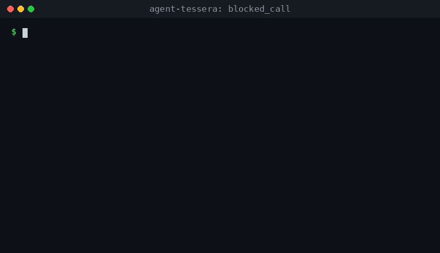

# Agent Tessera

[](https://github.com/agent-tessera/agent-tessera/actions/workflows/ci.yml)
[](https://pypi.org/project/agent-tessera/)
[](https://pypi.org/project/agent-tessera/)
[](LICENSE)

**Default-deny permissions and a tamper-evident audit log for AI agents,
whatever LLM they call.**



Write what an agent may do in a short YAML file. Agent Tessera checks every
model call, tool call, and agent-to-agent call against it, in your process,
with no network round trip. Everything it decides is written to a hash-chained
audit log you can verify.

- **Mandate:** plain-YAML, default-deny permissions over models, tools, data,
  and other agents, plus quotas and approvals.
- **Audit:** a hash-chained log, with optional OpenTelemetry export.
- **Identity:** short-lived, signed credentials per agent (with the server).
- **Control:** a registry, a kill switch, and a web console (with the server).
- **Provider neutral:** OpenAI, Anthropic, Bedrock, Gemini, LiteLLM, plus
  LangChain, MCP, the OpenAI Agents SDK, and CrewAI.

## Quickstart

No server and no API key. You need Python 3.11 or newer.

```bash
pip install agent-tessera
```

Save a policy as `policy.yaml`. Anything it does not allow is denied:

```yaml
apiVersion: tessera/v1
kind: AgentPolicy
metadata:
  agent: demo
spec:
  tools:
    allow: ["files.read"]
```

Save an agent as `agent.py`. It has one tool the policy allows and one it does not:

```python
from pathlib import Path

from agent_tessera import Denied, Tessera

tessera = Tessera("demo", policy="policy.yaml")


@tessera.tool("files.read")
def read_file(path: str) -> str:
    return Path(path).read_text(encoding="utf-8")


@tessera.tool("shell.run")
def run_shell(command: str) -> str:
    raise RuntimeError("never reached")


with tessera.task():
    print(read_file("policy.yaml").splitlines()[0])
    try:
        run_shell("rm -rf /")
    except Denied as err:
        print("blocked:", err)

tessera.close()
```

Run it and verify the audit log:

```bash
python agent.py
tessera audit verify .tessera/audit.jsonl
```

```text
apiVersion: tessera/v1
blocked: deny tool 'shell.run': not_granted
OK: 5 events
```

The denied function never ran, and the denial is in the log. Edit any event
in `.tessera/audit.jsonl` and verification fails:

```bash
sed -i 's/"effect":"deny"/"effect":"allow"/' .tessera/audit.jsonl
tessera audit verify .tessera/audit.jsonl
# FAILED at line 4: hash mismatch
```

To govern an LLM client instead of a function, wrap it:

```python
from openai import OpenAI

client = tessera.wrap(OpenAI())  # needs: pip install "agent-tessera[openai]"
```

More runnable examples are in [`examples/`](examples). Policy fields are in
[docs/policies.md](docs/policies.md).

## What it does and does not protect against

Agent Tessera enforces policy **inside your agent's process**, on the calls
you route through it. Be clear about what that means:

- **It stops** an agent that uses the governed tools, clients, and sessions
  from doing something its policy does not allow, and it records every
  decision in a log that shows tampering.
- **It does not sandbox the process.** Code that calls a provider's HTTP API
  directly, or imports a tool without decorating it, is not checked. Set
  `detect_bypass=True` to record calls to OpenAI, Azure OpenAI, Anthropic,
  Gemini, and Bedrock that skip the adapters as `ungoverned_call` events. That
  detects the gap but does not close it.
- **It does not defend against a hostile process.** Anything that can run
  arbitrary code in the agent's process can disable the SDK. Pair it with OS
  or container isolation and network egress rules for untrusted agents.
- **It does not track data between agents.** If agent A may read something
  that agent B may not, A can still pass it to B in a message.

[docs/threat-model.md](docs/threat-model.md) has the full list.

## Server

The SDK works alone. For a fleet, run the control plane. It registers agents,
issues short-lived credentials, signs and distributes policy bundles, collects
audit events, tracks guardrail posture, and serves a web console at `/app`:

```bash
pip install agent-tessera-server
tessera server dev
```

`tessera server dev` migrates a local SQLite database, listens on
`127.0.0.1:8700`, and prints an admin key. Point an agent at it with
`TESSERA_URL=http://127.0.0.1:8700`. [docs/server.md](docs/server.md) covers
Docker Compose, Postgres, registration, the kill switch, run revocation, fail
modes, and token leases.

## Optional extras

`pip install agent-tessera` installs `httpx`, `pydantic`, `pyjwt`, and
`pyyaml` only. Provider and framework packages are extras:

| Extra | What it adds |
| --- | --- |
| `openai` | OpenAI and Azure OpenAI client adapter |
| `anthropic` | Anthropic client adapter |
| `bedrock` | Amazon Bedrock adapter |
| `gemini` | Gemini adapter |
| `litellm` | LiteLLM adapter |
| `otel` | OpenTelemetry export |
| `langchain` | LangChain and LangGraph tools |
| `mcp` | MCP client session |
| `openai-agents` | OpenAI Agents SDK hooks |
| `crewai` | CrewAI tools |

For a client without an adapter, register your own. See
[docs/integrations.md](docs/integrations.md).

## Documentation

- [Quickstart](docs/quickstart.md) and [policies](docs/policies.md)
- [Server](docs/server.md), [registry](docs/registry.md), and
  [tracing](docs/tracing.md)
- [Integrations](docs/integrations.md) and [footprint](docs/footprint.md)
- [Threat model](docs/threat-model.md)

To build the API reference locally: `uv run mkdocs serve`.

## Status and roadmap

Agent Tessera is at version 0.8.0 and in alpha. Expect API changes before 1.0,
and read [CHANGELOG.md](CHANGELOG.md) when you upgrade.

Planned before 1.0: a stable API and policy format, agent-to-agent identity
with A2A Agent Cards, and sub-agent spawning with permission attenuation.
Later: a gateway mode for agents you cannot modify, and a TypeScript SDK.
Larger integrations (SAML, SCIM, Slack or Teams approvals, SIEM connectors)
are not built yet and are open for contributors.

## Contributing

Issues and pull requests are welcome. See [CONTRIBUTING.md](CONTRIBUTING.md)
and the [Code of Conduct](CODE_OF_CONDUCT.md). Report security issues privately
as described in [SECURITY.md](SECURITY.md).

## License

Apache 2.0. See [LICENSE](LICENSE).
