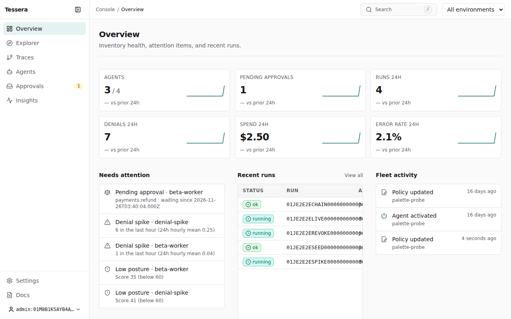
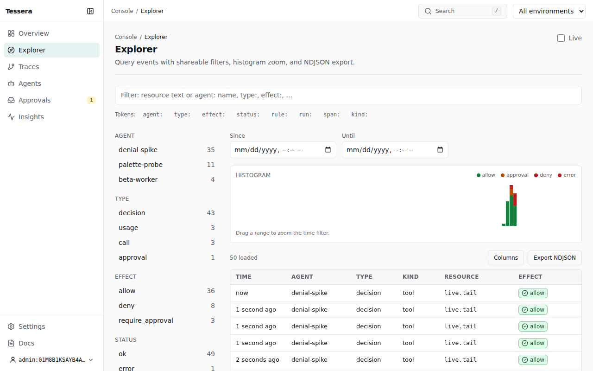
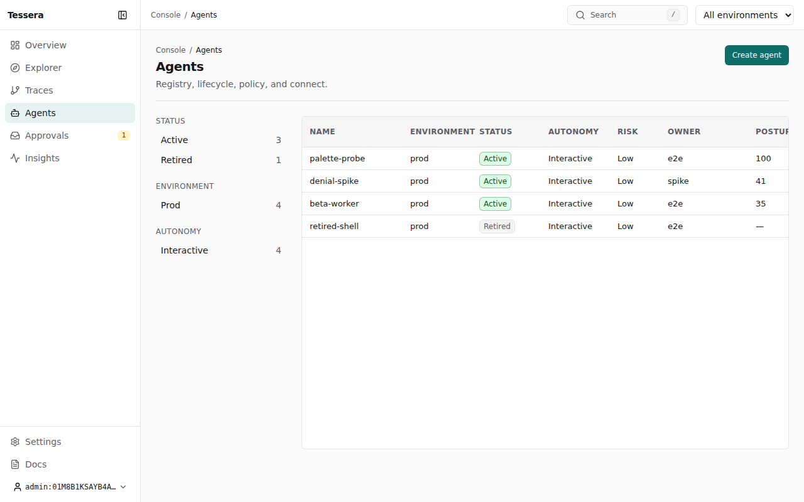
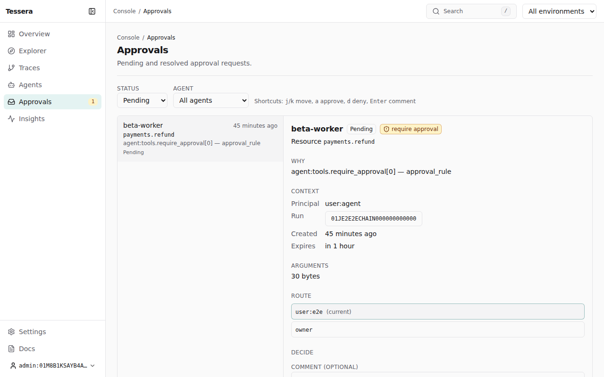
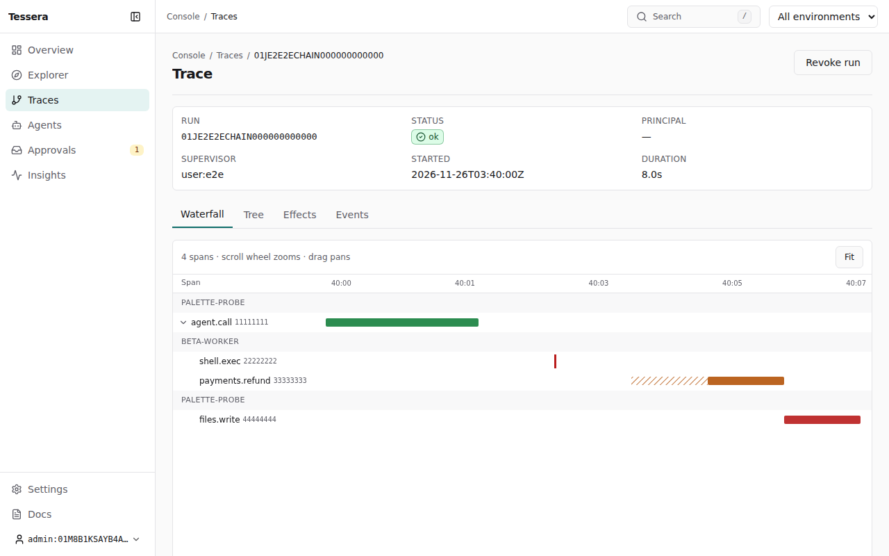

# Control plane

The server registers agents, issues short-lived credentials, distributes
signed policy bundles, and stores the audit trail. The SDK still evaluates
each action in process. A decision does not wait on the network.

## Run locally

From a checkout, with the server package installed:

```bash
uv run tessera server dev
```

The command migrates a SQLite database at `.tessera/server.db`, prints
`http://127.0.0.1:8700`, and then prints an admin key. It listens only on
`127.0.0.1`. Another `--host` exits with `dev mode binds 127.0.0.1 only`.
`--port` changes the port. When `TESSERA_SERVER_ISSUER` is unset, the issuer
is that printed URL.

`/healthz` returns `{"status": "ok", "dev": true}`. The React console is at
`/app` (the default landing from `/`). Sign-in is at `/login` (or SSO). On
this loopback server the console pages are available without signing in.
Paste the admin key on `/login` when you open the UI from somewhere else.
Legacy `/ui/login` redirects to `/login` for one release.

A client that has only `TESSERA_URL` set registers itself. The server creates
an owner `dev@localhost`, an agent in the `dev` environment, and a permissive
policy when that agent does not exist yet. See
`policies/examples/dev-permissive.yaml`.

```bash
TESSERA_URL=http://127.0.0.1:8700 uv run python examples/server_agent/agent.py
```

The example prints a decision for `files.read`, `files.delete`, and
`shell.exec`. On the development policy all three are allowed.

## Console

From v0.6 the operator surface is the React console at `/app`. Start the
development server, open `http://127.0.0.1:8700/` (redirects to
`/app/overview`), and use the sidebar: **Overview**, **Explorer**,
**Agents**, **Traces**, **Approvals**, **Insights**, and **Settings**.
Sign-in uses `/login` (or SSO); after login the browser lands on
`/app/overview`. Classic Jinja operator pages under `/ui` were removed in
v0.7; legacy `/ui/*` paths redirect to `/app/overview`.

Screenshots below come from the Playwright suite
(`web/tests/e2e/screenshots.spec.ts` against the seeded e2e server).
Regenerate them with `npm --prefix web run build && npm --prefix web run
screenshots`.

**Overview.** KPIs for the last 24 hours, needs-attention cards (denial
spikes, pending approvals, low posture), recent runs, and (from v0.6.1) a
Fleet activity strip that polls recent revocations.



**Explorer.** Structured query chips (`agent:`, `type:`, `effect:`, …),
facet counts, histogram brush, live tail, and a detail drawer per event.



**Agents.** Inventory with status, environment, autonomy, posture, and
create / lifecycle actions. Open a row for policy, access footprint,
metadata edit, connect, instances, and activity.



**Insights (v0.6.1).** Spend, denials, footprint, posture, and **Quotas**
(usage vs ceilings from `GET /v1/quotas`).

**Settings (v0.6.1).** Owners directory, alerts, webhooks (including edit),
baselines, custody, admin keys, and Audit (chain verify + log).

**Approvals.** Split inbox: filter pending requests, decide with a comment,
or follow the run link into the waiting span on the trace.



**Traces.** Run list and a virtualized waterfall with agent swimlanes,
denial markers, and approval hatching. See [Governance traces](tracing.md)
for span ids, cross-agent parents, and the OpenTelemetry link.



Command palette: `⌘K` / `Ctrl-K` / `/` searches agents, runs, spans, and
rules. Paste a 16-hex span id to jump to its run. Theme toggle lives under
the actor menu (light and dark).

## First hour

Start the development server and leave it running:

```bash
uv run tessera server dev
```

The first printed line is `http://127.0.0.1:8700`. The next line is the
admin key (`tsa_...`). Open `http://127.0.0.1:8700/` (redirects to the
React console at `/app`; post-login lands on `/app/overview`). On this
loopback server the console loads without the login form. Elsewhere, paste
the admin key on `/login`; that creates a server-side session cookie
(`tss_…`) with idle and absolute limits (see
[Admin UI sessions](#admin-ui-sessions) below).

Primary navigation in the console is **Overview**, **Explorer**,
**Agents**, **Traces**, **Approvals**, **Insights**, and **Settings**,
with theme and **Log out** under the actor menu. An empty org Overview
offers onboarding (create agent → policy template → connect → first
event).

Register an agent named `playground` in the `dev` environment. Open
**Agents**, choose **New agent**, set the name to `playground`, leave the
environment as `dev`, and set the owner email to `playground@localhost`.
The agent is created as `draft`. Or start from **Start onboarding** on
Overview when the org has no agents yet.

The same registration from another terminal, using the printed admin key:

```bash
TESSERA_ADMIN_KEY='tsa_...' uv run tessera agents register playground \
  --owner playground@localhost \
  --env dev \
  --server http://127.0.0.1:8700
```

Run the server demo against that agent
(`examples/server_agent/agent.py`):

```bash
TESSERA_URL=http://127.0.0.1:8700 uv run python examples/server_agent/agent.py playground
```

The development server attaches the permissive policy and activates a
`draft` agent when the example connects. The three lines are `allow` with
reason `allow_rule`:

```text
files.read: allow (allow_rule)
files.delete: allow (allow_rule)
shell.exec: allow (allow_rule)
```

After that run, open these console pages (loopback needs no login):

| URL | What you should see |
| --- | --- |
| `/app/overview` | Overview tiles; posture / needs-attention; fleet activity |
| `/app/agents` → `playground` | Overview, Policy, Access, Instances, Connect, Activity |
| `/app/approvals` | Empty pending list until a policy requires approval |
| `/app/explorer` | Live / filtered event stream |
| `/app/insights` | Spend, denials, footprint, posture, quotas |
| `/app/settings/alerts` | Alert rules (Create / Delete) |
| `/app/settings/webhooks` | Outbound webhooks and Send test |

Open the `playground` row and press **Suspend**. The status chip reads
`suspended`. Run the demo again. The server rejects the suspended agent,
and the process exits with `ServerError: server returned 403`. Press
**Activate** on the same page to allow the example again.

**Approvals.** For a deny or approval outcome, edit the policy on the
agent **Policy** tab (or use `examples/approvals/agent.py` with a policy
that `require_approval` on `files.delete`). Open **Approvals**. The list
defaults to pending requests, and the navigation badge is that count. A
row shows Why, Run, age, resource, effect, and time left. **Approve**
resolves to allow; **Deny** leaves the agent call denied. Keyboard
shortcuts (`j`/`k`, `a`/`d`, `Enter`, `?`) work when the inbox has focus.
A pending request past half of its timeout is highlighted.

**Activity.** From an agent, open the **Activity** tab for a live fragment,
or use **Activity → Live** / **Audit** in the primary nav. Live rows show
time, agent, kind, resource, effect, duration, and rule, with a **Pause**
checkbox. Audit filters by agent name, type, effect, and since window;
each row expands to the stored JSON. **Verify chain** shows an ok or
failed banner.

**CLI.** Store a profile with `tessera login --server URL`, then use
`tessera status`, `tessera approvals ls|show|approve|deny`, and
`tessera events tail` without exporting `TESSERA_ADMIN_KEY` every time.
`TESSERA_URL` / `TESSERA_ADMIN_KEY` still override the file.

**Offline SDK half.** Without a server, follow [Quickstart](quickstart.md)
(`examples/quickstart/agent.py`). That walkthrough allows `files.read`,
requires approval for `files.delete`, and denies `shell.*` — no API keys
and no control plane.

## Docker Compose

Copy `.env.example` to `.env`. Set `POSTGRES_PASSWORD` and
`TESSERA_SERVER_KEK` to a base64-encoded 32-byte key:

```bash
python -c "import os, base64; print(base64.b64encode(os.urandom(32)).decode())"
```

Then:

```bash
docker compose up --build
```

Compose starts Postgres 16 and the server. The server container runs
`tessera server migrate` and then listens on port 8700 as a non-root user.
The database URL points at the Postgres service. `TESSERA_SERVER_ISSUER`
defaults to `http://127.0.0.1:8700`.

This mode is not the development server. Clients need a registration token,
and `/ui` asks for the admin key. Create one with:

```bash
docker compose exec server tessera server create-admin-key --name ops
```

The key is printed once. It starts with `tsa_`.

## Helm

The chart in `deploy/helm/agent-tessera` installs a Deployment, a Service, a
ConfigMap, and a Secret. Ingress is off until `ingress.enabled` is true.
An external database is the default: set `database.url`. Set
`postgresql.enabled` only for a trial of the bundled Postgres subchart.

`kek.value` is the base64 of 32 bytes. `kek.existingSecret` names a Secret
you manage. That Secret must contain `TESSERA_SERVER_KEK` and
`TESSERA_SERVER_DATABASE_URL`. `issuer` is the public base URL. `oidc.issuer`,
`oidc.clientId`, and `oidc.clientSecret` turn on admin SSO. The chart README
has the install command. Render it with `helm dependency update` and then
`helm template`. No cluster is required for that check.

### Upgrade from 0.3

Reuse the existing Postgres database and the existing key-encryption key.
Set `database.url`, or point `kek.existingSecret` at a Secret that already
has `TESSERA_SERVER_KEK` and `TESSERA_SERVER_DATABASE_URL`. The chart never
generates a KEK. OIDC remains optional. On start the pod runs
`tessera server migrate`, which applies Alembic revisions through head
`0012`. The chart README shows the `helm template` commands for the
external-database default, the bundled-Postgres trial, and an existing
Secret.

## Register an agent

Send the admin key as `Authorization: Bearer <key>`.

```bash
curl -s -X POST http://127.0.0.1:8700/v1/owners \
  -H "Authorization: Bearer $TESSERA_ADMIN_KEY" \
  -H "Content-Type: application/json" \
  -d '{"type":"user","email":"ada@example.com","display_name":"Ada"}'
```

Use the returned `id` as `owner_id`:

```bash
curl -s -X POST http://127.0.0.1:8700/v1/agents \
  -H "Authorization: Bearer $TESSERA_ADMIN_KEY" \
  -H "Content-Type: application/json" \
  -d '{"name":"triage","environment":"prod","owner_id":"<owner id>"}'
```

The agent starts as `draft`. Upload a policy whose `metadata.agent` and
`metadata.environment` match the agent, then activate it. Activation without
a policy returns 409.

```bash
curl -s -X PUT http://127.0.0.1:8700/v1/agents/<agent id>/policy \
  -H "Authorization: Bearer $TESSERA_ADMIN_KEY" \
  -H "Content-Type: application/yaml" \
  --data-binary @policy.yaml

curl -s -X POST http://127.0.0.1:8700/v1/agents/<agent id>:activate \
  -H "Authorization: Bearer $TESSERA_ADMIN_KEY"
```

A baseline is a separate YAML document. Its name in the URL must match
`metadata.name`. A baseline whose selector matches the agent is part of the
bundle the client receives.

```bash
curl -s -X PUT http://127.0.0.1:8700/v1/baselines/prod-guard \
  -H "Authorization: Bearer $TESSERA_ADMIN_KEY" \
  -H "Content-Type: application/yaml" \
  --data-binary @baseline.yaml
```

The admin UI has the same operations. **New agent** registers a draft, and
**Upload baseline** stores a baseline. The agent page uploads a policy,
suspends, activates, retires, and creates a registration token. Check
**Reusable** and fill in **Expires in seconds** for a token that more than
one instance can use. A rejected form stays on the page and shows the API
error.

## Registration token

```bash
curl -s -X POST http://127.0.0.1:8700/v1/agents/<agent id>/registration-tokens \
  -H "Authorization: Bearer $TESSERA_ADMIN_KEY" \
  -H "Content-Type: application/json" \
  -d '{"reusable": false}'
```

The response field `token` starts with `tsr_` and is shown once. The default
token works for one instance. `"reusable": true` lets more than one instance
use it. `"expires_in"` is a lifetime in seconds. Omit it for no expiry.

Give that value to the process as `TESSERA_AGENT_TOKEN`.

## Admin SSO

Admin SSO is the browser UI. The HTTP API still uses an admin key (`tsa_`).
Set these on the server:

| Variable | Meaning |
| --- | --- |
| `TESSERA_OIDC_ISSUER` | Identity provider issuer. SSO stays off when this is empty. |
| `TESSERA_OIDC_CLIENT_ID` | OAuth client id. |
| `TESSERA_OIDC_CLIENT_SECRET` | OAuth client secret. |
| `TESSERA_OIDC_REDIRECT_URL` | Callback. The default is `{issuer}/oidc/callback`. |
| `TESSERA_OIDC_REQUIRED` | `1` hides the admin-key form. |
| `TESSERA_OIDC_ADMIN_GROUP` | When set, the ID token `groups` claim must include this value. |

Open `/oidc/start`. The server redirects to the provider and, after the
callback, starts a session and sends the browser to `/app/overview`.
Legacy `/ui/oidc/*` paths redirect for one release. The session cookie
authorizes browser calls to `/v1` (with CSRF on mutates); use an admin key
for `curl`. When `TESSERA_OIDC_REQUIRED` is `1`, the login form is hidden
and the admin key still works on the API.

### Admin UI sessions

Signing in with the admin-key form or with SSO creates a session on the
server. The browser cookie holds only an opaque `tss_` value. It never holds
the admin key or the SSO subject. The server stores a hash of the cookie
secret, so a copied database row cannot be replayed as a cookie.

| Variable | Default | Meaning |
| --- | --- | --- |
| `TESSERA_SERVER_SESSION_IDLE` | `8h` | A session with no request for this long ends. |
| `TESSERA_SERVER_SESSION_MAX` | `24h` | A session ends this long after sign-in, whatever its use. |

Both accept `Nh`, `Nm`, `Ns`, or a number of seconds. **Log out** ends the
session on the server. Revoking or rotating an admin key ends every session
created with it. An SSO session ends when SSO is no longer configured. Each
sign-in and log out writes an `admin_login` or `admin_logout` audit row with
the session id, not the cookie.

Mutating `/ui` forms include a CSRF token. A missing or wrong token returns
403. htmx requests send the same value as `X-CSRF-Token`. The login form and
development loopback stay exempt.

An admin key is break-glass. Turning on SSO does not retire it. Anyone who
holds the key can change agents, policies, and provider secrets. Keep few
keys, store them the way you store the key-encryption key, and create a
replacement if one might have leaked. The server stores only a hash of the
key. It does not write the admin key, the OIDC client secret, or a provider
API key to the log.

To replace a break-glass key and disable the previous one with the same name:

```bash
tessera server rotate-admin-key --name ops
```

The new key is printed once. An audit row records the new and previous key
ids, not the secrets. The old key is rejected on the API and the login form,
and admin UI sessions started with it end.

## Workload identity

A process that can present an OIDC JWT can skip the registration token.
`TESSERA_WORKLOAD_BINDINGS` is a JSON list. The first object whose `issuer`,
`agent`, and `environment` match the request is used. `audience` must equal
the token audience. `claim` defaults to `sub` and must be a non-empty string.

```bash
export TESSERA_WORKLOAD_BINDINGS='[
  {"issuer":"https://kubernetes.default.svc","audience":"tessera",
   "agent":"billing","environment":"prod","claim":"sub"}
]'
```

On Kubernetes, project a service-account token into the pod (the projected
volume at `/var/run/secrets/kubernetes.io/serviceaccount/token`). Set the
binding `issuer` to that cluster's issuer. `https://kubernetes.default.svc`
is the usual in-cluster issuer; use the issuer your API server actually puts
in the token. The token `sub` looks like
`system:serviceaccount:prod:billing`. The audience is the one you requested
in the projection, and it must match the binding.

```bash
curl -s -X POST http://127.0.0.1:8700/v1/token \
  -H "Content-Type: application/json" \
  -d '{"grant_type":"workload","assertion":"<sa jwt>",
       "agent":"billing","environment":"prod",
       "instance_id":"<32 hex>","runtime":{}}'
```

The response is the same runtime JWT a registration token would return. A
wrong audience is `401`. The grant type is `workload`. The assertion is an
OIDC JWT, including a Kubernetes service-account token. There is no separate
grant for cloud instance metadata.

## SDK server mode

```python
import os

from agent_tessera import Tessera
from agent_tessera.types import Action

os.environ["TESSERA_URL"] = "http://127.0.0.1:8700"
os.environ["TESSERA_AGENT_TOKEN"] = "tsr_..."

with Tessera("triage") as client:
    with client.task("demo"):
        client.enforce(Action.tool("files.read"))
```

`server_url` and `agent_token` arguments override the environment variables.
The agent name must be the name registered on the server. A local `policy`
argument, or `TESSERA_POLICY`, together with a server URL raises
`ConfigError`. The server is the source of the policy.

On startup the client exchanges the registration token for a short-lived
credential, verifies the signed bundle, and caches both under
`.tessera/cache` (or `TESSERA_CACHE_DIR`). Later `check` and `enforce` calls
use that cache. A background thread refreshes the credential and polls for a
new bundle. Another thread follows `GET /v1/revocations/stream` and uploads
events to `POST /v1/events`.

Events stay in memory until an upload fails, then they are written under
`TESSERA_SPOOL_DIR` (default `.tessera/spool`) and sent when the server is
reachable again. `close()` writes a stop event and flushes. A local
`.tessera/audit.jsonl` file is written only when you pass `audit_path` or set
`TESSERA_AUDIT_PATH`.

A token request may send `bound_supervisor` (`user:` or `group:`). That value
is stored on the instance. `task(..., supervisor=)` and the first event that
names a supervisor store the run binding, and a later event does not replace
it. The supervisor used for a run is that run binding, then the instance
binding, then the first static supervisor.

`client.mode` is `"server"`. `client.policy` is the effective policy, or
`None` when fail-open mode has no bundle yet.

## Kill switch

Suspend an agent to deny every later action. The client learns this from the
revocation stream and reports reason `suspended`. `resume()` on the client
does not clear a server suspension. Activate the agent to allow calls again.

```bash
curl -s -X POST http://127.0.0.1:8700/v1/agents/<agent id>:suspend \
  -H "Authorization: Bearer $TESSERA_ADMIN_KEY"

curl -s -X POST http://127.0.0.1:8700/v1/agents/<agent id>:activate \
  -H "Authorization: Bearer $TESSERA_ADMIN_KEY"
```

Revoking one instance (`POST /v1/instances/<instance id>:revoke`) suspends
that instance only. Retiring an agent is permanent.

`client.suspend()` is a local switch for the current process. It does not
change the agent on the server.

## Circuit breaker

A policy `circuit_breaker` counts denial decisions inside its window. Offline,
that count is per process. In server mode the SDK uploads those decisions and
the server counts them for the agent. When the count reaches `denials`, the
server carries out `action`: `suspend` (the same revocation as an admin
suspend) or `revoke_run` (the run named by the denial's task). A
`circuit_open` decision does not count again. The client also applies the
action locally, so the next check is `suspended` or `run_revoked`.

## Approvals

`POST /v1/approvals` with a runtime token stores a request and returns
`{id, status, expires_at}`. The route comes from the agent policy. `principal`,
`supervisor`, and `owner` are resolved to a party; an entry with nobody to ask
is skipped. When none remain, the response is 422 `approval_unavailable`.
Each party is offered the request for `approvals.timeout`. The server process
advances `route_index` when that time passes. After the last party, the status
is `timeout`.

An admin key may approve or deny a pending request. A runtime token may do so
only when it is the party currently offered the request, it is not the
requesting agent, and it does not take part in the run. With
`forbid_self_approval` (the default), the requesting principal cannot approve
it either. A second decision returns 409.

`GET /v1/approvals/{id}` is open to that agent and to an admin.
`GET /v1/approvals` is admin-only and accepts `status` and `agent_id`.

The console lists requests at `/app/approvals`. Open one to approve or deny
it. The signed-in admin's name is the approver.

`examples/approvals/agent.py` is a client that blocks on `files.delete`
until the server grants the approval. Set `TESSERA_URL` and
`TESSERA_AGENT_TOKEN`. The integrations are documented in
[Integrations](integrations.md).

## Webhooks

`POST /v1/webhooks` stores `{url, events, secret, active}`. An empty `events`
list delivers every event. `secret` is optional and is not returned; the
document says `has_secret` instead. `PUT` and `DELETE` use the same admin key.
`GET /v1/webhooks` lists endpoints.

When an approval is created or escalated, the server POSTs
`approval.requested`. An approval, denial, or timeout posts
`approval.resolved`. The body is JSON. The header `X-Tessera-Signature` is
`sha256=` plus the HMAC-SHA256 hex of that body. An endpoint secret overrides
`TESSERA_WEBHOOK_SECRET`. Delivery tries three times. A failure is written to
the audit log and does not fail the approval request. Redirects are not
followed.

Set `TESSERA_WEBHOOK_URL` to register one catch-all endpoint at startup. It
uses `TESSERA_WEBHOOK_SECRET` unless an endpoint stores its own secret.

## Posture

`GET /v1/agents/{id}/posture` scores the last seven days. `coverage` is the
share of required input guardrails (`input.*`) that ran. It is 1 when the
policy requires none, and 0 when no readable policy is stored. `score` is an
integer from 0 to 100:

| Component | Points |
| --- | --- |
| Active owner | 20 |
| Agent policy lists every required guardrail | 20 |
| Coverage | 30 times coverage |
| Denial rate | 15 at or below 5 percent, 0 above 25 percent, linear between. No decisions score 15. |
| No `ungoverned_call` | 15 |
| Probe results | 0 until verified probes exist |

A guardrail counts as run when a `guardrail` event in the window has
`status: ran`. Denial rate is `deny` decisions divided by decision events.
The score rounds half up. The agent page lists each component. The overview
lists each agent's score and coverage.

## Key custody

`POST /v1/custody/secrets` stores a provider API key. The body is `name`,
`provider`, and `secret`. The server encrypts `secret` with its key-encryption
key and does not return the plaintext. `GET /v1/custody/secrets` lists each
key's id, name, and provider. `GET` and `PUT /v1/custody/secrets/{id}` return
those same fields. `PUT` can replace the name, provider, or secret.
`DELETE /v1/custody/secrets/{id}` removes the row. These routes require an
admin key. The audit log records the id, name, and provider.
Console Settings → Custody shows the same id, name, and provider list.
Creating or revealing a secret stays on the API; the page never shows
plaintext or ciphertext.

`POST /v1/custody/issue` is for a runtime JWT. The body names a `provider`
or a `name`. The response is `provider`, `api_key`, and `expires_at`. The
lifetime defaults to 60 seconds and cannot exceed 120. The audit row records
the agent, instance, and expiry, not the key. A provider that matches more
than one stored key is rejected until the request names one. Set
`TESSERA_KEY_CUSTODY=1` on the SDK to fetch a key before each governed model
call, sets `api_key` on the wrapped client for that provider, and restores
the previous value when the call returns. Offline mode does not fetch a key.

## Dashboards

`GET /v1/dashboards/summary` returns inventory counts, orphaned agents,
dormant agents, pending approvals, `spend_24h`, and `denials_24h`. A dormant
agent is not retired and has no event in the last seven days. Spend is the
sum of `usage` event `cost_usd` values. Denials are `decision` events whose
effect is `deny`. Both `spend_24h` and `denials_24h` use the inclusive window
`[now - 24h, now]`, the same window as the console Insights dashboards.
Events after now are not counted.

`/app/insights` shows the same totals. A bar chart is drawn when a value is
above zero. Spend defaults to the last 24 hours and can group by agent or
model.

`GET /v1/dashboards/spend` takes inclusive `from` and `to` timestamps and
`group_by=agent` or `group_by=model`. Agent rows include `agent_id` and
`name`. Model rows include `model`. `GET /v1/dashboards/denials` uses the
same window and groups by agent.

## Footprint

`GET /v1/footprint` totals stored events. `agent_id`, `from`, and `to` are
optional. `from` and `to` are ISO-8601 timestamps. The totals are
`tokens_in`, `tokens_out`, `cost_usd`, `model_calls`, `tool_calls`, and
`denials`. It also returns `energy_j`, `co2e_g`, and `estimate: true`.
Energy is joules from `pricing/energy.json` (joules per 1,000 tokens).
Carbon uses that file's `grid_g_co2_per_kwh`. A usage event whose model is
not in the table makes both numbers null. The agent page shows the same
token, cost, and call totals for that agent.

`GET /v1/agents/{id}/footprint/access` compares the effective policy's grants
with the last 30 days of events. It uses the same rules as
`tessera footprint`: an allow or `require_approval` decision is observed, a
call is observed by its resource, and an unused grant matches no observed
resource of that kind. A missing policy returns empty lists.

The server stores every uploaded event. It does not sample events or drop
them by age.

## Live activity

The console Explorer live tail streams recent `call` and `decision` events
via `GET /v1/events/stream`. Agent Activity and Traces deep-link into the
same event set.

## Alerts

`POST /v1/alerts` stores a rule. `metric` is one of the footprint totals.
`threshold` is a positive number. `window` is a duration such as `30s`,
`10m`, or `1h`, at most `168h`. `selector.labels` and `selector.autonomy`
choose which active agents the rule watches. `action` is `webhook` or
`suspend`.

The server evaluates rules on the same one-second loop as approval
escalation. A footprint at or above the threshold emits `monitor.alert`.
`suspend` also suspends that agent. The same rule does not fire again for
that agent until the window has passed. Alert rules are managed at
`/app/settings/alerts`.

## Effect ledger

A governed process can record what a run changed with `record_effect`. The
server keeps the opaque `ref`, whether it is reversible, and an optional undo
tool name. It does not store the content of the change.

```bash
curl -s http://127.0.0.1:8700/v1/runs/<task id>/effects \
  -H "Authorization: Bearer $TESSERA_ADMIN_KEY"
```

The admin run page lists the same references.

## Revoke a run

A task id is the run id. The server creates the run when it ingests an event
that names that task. Revoking it denies later actions inside that task, on
every instance, with reason `run_revoked`. Actions outside the task are
unchanged.

```bash
curl -s -X POST http://127.0.0.1:8700/v1/runs/<task id>:revoke \
  -H "Authorization: Bearer $TESSERA_ADMIN_KEY"
```

A missing run returns 404. Revoking it twice returns 409. While the agent
itself is suspended, decisions use reason `suspended` first.

`GET /v1/audit/verify` reports whether the server's hash chain is intact.
`GET /v1/audit` lists ingested events. Both require the admin key.

## Fail modes

`fail_mode` is `closed` or `open`. The argument wins, then
`TESSERA_FAIL_MODE`, then `open` when `TESSERA_ENV` is `dev`, otherwise
`closed`.

When the server is unreachable at startup and a valid cache exists, both
modes start with the cached policy. With no usable cache, `closed` raises
`ServerError` and `open` allows actions with reason `fail_open`. A rejected
credential refresh denies every action with reason `suspended` in either
mode.

A cache file that fails signature checks is treated as missing. A 4xx
response at startup does not fall back to the cache.

## Leases

When the effective policy sets `limits.tokens_per_day`, every instance of
that agent shares the budget. The client requests a lease from
`POST /v1/quotas/leases` and renews it in the background. `enforce` does not
call the server for this.

Until the first grant arrives, model calls are denied with reason `limit`
and rule `agent:limits.tokens_per_day`. A lease lasts five minutes. Closing
the client reports how many tokens it used so the remainder can be granted
again. An expired lease that was never closed counts as fully used.

The same endpoint leases a named quota. The body defaults `metric` to
`tokens` and `quota_name` to `tokens_per_day`, which is the daily token
lease above. A named quota adds `resource`, `principal`, `run_id`, and
`requested`. The response keeps `day` and `limit` and adds `remaining`.
`cost_usd` counts millionths of a dollar; every other metric counts whole
units. `agent` and `org` quotas are keyed by the agent. `principal`,
`supervisor`, and `run` quotas are keyed by that id, and a missing id is
rejected. `scope: instance` and `window: call` do not take a server lease.
A quota with `on_exhausted: suspend` suspends the agent when its budget is
empty and writes the same revocation as an admin suspend. The SDK leases
agent, org, principal, and run quotas. Instance quotas stay on the instance.
A model call holds `ceil(max(1, ceil(chars / 4)) * 1.1) + max_output_tokens`
and then reports the measured usage.
